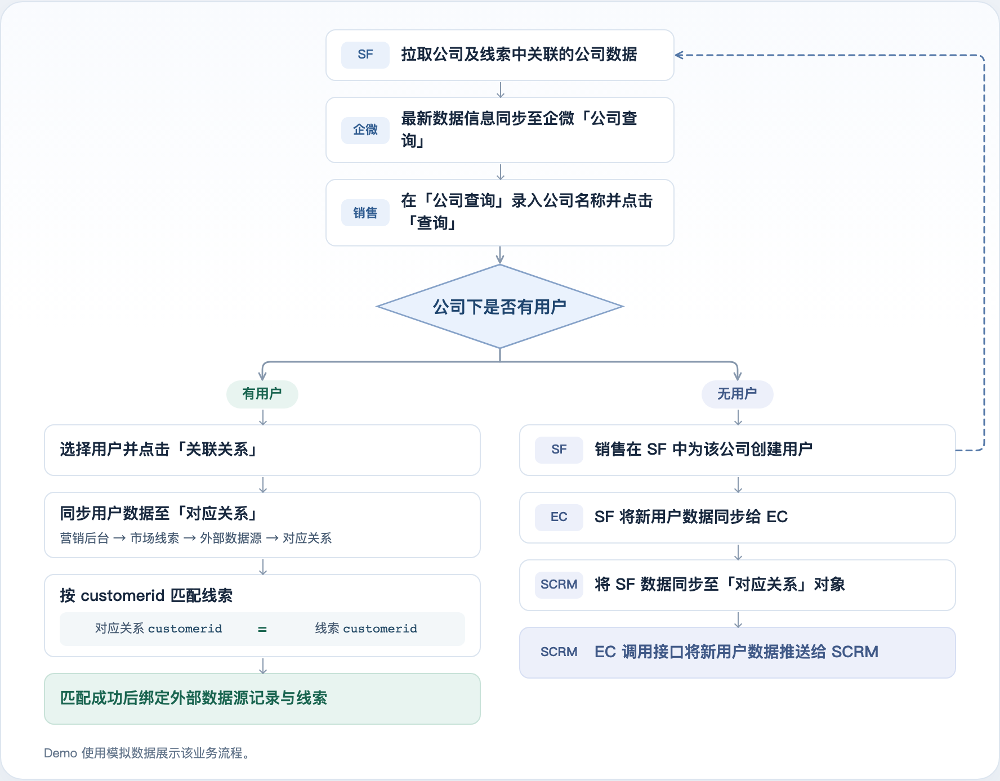

# 西诺公司查询与数据流转演示

公司查询、用户关联和营销后台「对应关系」的静态演示页面。

## 使用

直接在浏览器中打开 `index.html`。进入「数据流转图」页签查看完整流程，也可以使用页面地址后的 `#flow` 定位该页签。

演示使用模拟数据，交互状态保存在浏览器本地。

## 数据流转

1. 拉取公司及线索中关联的公司数据，并将最新数据信息同步至企微。
2. 在「公司查询」录入公司名称，点击「查询」。
3. 判断公司下是否有用户：
   - 有用户：选择用户并点击「关联关系」，同步用户数据至「对应关系」，按 `对应关系.customerid = 线索.customerid` 匹配线索。
   - 无用户：销售在 SF 中创建用户 → SF 将数据同步给 EC → SCRM 将 SF 数据同步至「对应关系」对象 → EC 调用接口将新用户数据推送给 SCRM。

「对应关系」入口：营销后台 → 市场线索 → 外部数据源 → 对应关系。

## 文件

- `index.html`：完整演示页面，无需安装依赖或构建。
- `data-flow.png`：更新后的流程图预览。
